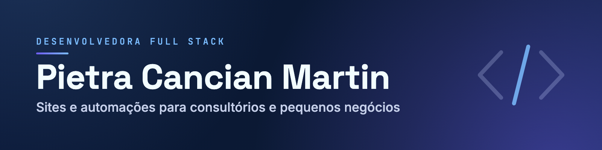

  

# Olá, eu sou a Pietra! 👋

**Desenvolvedora full stack.** Faço sites e automações para consultórios e pequenos negócios.

Antes do código, **oito anos de handebol profissional** 🤾‍♀️. Hoje jogo beach tennis, categoria Pro 🎾

Formada em Análise e Desenvolvimento de Sistemas pela FACENS, com MBA em andamento na USP.

  
  
  
  

---

## O que eu faço

- **Sites que levam a pessoa até você.** React, TypeScript, Vite e Tailwind, pensados para o celular e com caminho direto para o WhatsApp.
- **Automações com n8n.** O que alguém faz na mão toda semana vira fluxo: depoimento aprovado num clique, aviso no celular, números do Instagram atualizados sozinhos.
- **Lojas e sistemas com Supabase.** Catálogo, pagamento por PIX e painel de gestão.
- **Aplicativos nativos.** Swift e SwiftUI no iOS, Java no Android.

## Trabalhos

| Projeto | O que resolve | Tecnologias | Links |
|---|---|---|---|
| **Site do psicólogo Carlos Martin** | Depoimentos que se atualizam sozinhos: o paciente escreve no site, o psicólogo aprova por e-mail com um clique e a página publica. | React 18, TypeScript, Vite, Tailwind, Framer Motion, Radix UI, n8n | [No ar](https://www.psicologocarlosmartin.com.br/) |
| **UniformesCoach** | Loja com estoque em tempo real, PIX no checkout, painel administrativo e dashboard com exportação. | React, Vite, Tailwind, Supabase | [No ar](https://www.ctcoachdavidsousa.com.br/) · [Código](https://github.com/Picancianmartin/UniformesCoachSite) |
| **MedFlow** | App iOS nativo e offline-first que calcula a agenda de doses e dispara notificações locais. | Swift, SwiftUI, SwiftData, Combine | [Código](https://github.com/Picancianmartin/MedFlowiOS) · [Demo](https://picancianmartin.github.io/MedFlowiOS/) |
| **AulaGo** | MVP acadêmico, em equipe: app Android que conecta alunos e professores particulares de idiomas. | Java, Firebase, Google Sign-In | [Demo](https://www.pietramartin.dev/lp-aulago) · [Código](https://github.com/Jessica-G-arcia/AulaGo_mobile) |

## Feitos para mim, e funcionando

- **[Media kit de atleta](https://mediakit.pietramartin.dev):** lê o Instagram pela API oficial, via n8n, e mostra alcance, engajamento e cidades do público, sempre com a data e a hora da leitura.
- **[Cotador de orçamento](https://www.pietramartin.dev/orcamento):** cinco perguntas em português comum, e a faixa de preço e o prazo aparecem na hora.

## Stack

**Front-end**

  
  
  
  
  

**Back-end, dados e automação**

  
  
  
  
  

**Mobile e design**

  
  
  
  

Já usei: Angular, Bootstrap e Power BI.

## Trabalhe comigo

Faço sites e automações para consultórios e pequenos negócios. **[Descubra a faixa de preço e o prazo do seu em 1 minuto](https://www.pietramartin.dev/orcamento)**

Também estou aberta a oportunidades em equipe: [LinkedIn](https://www.linkedin.com/in/martinpietra/) ou contato@pietramartin.dev.

Conteúdo sobre sites e automação no Instagram: [@pietramartin.dev](https://www.instagram.com/pietramartin.dev/)
